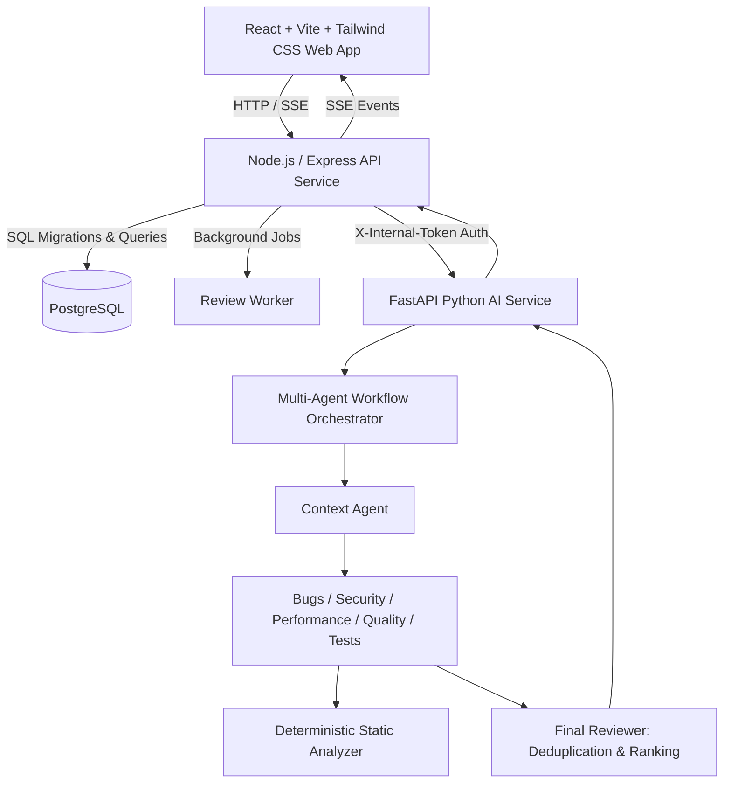

# CodeMind AI — Autonomous Multi-Agent Code Review Platform

CodeMind AI is a full-stack, production-ready multi-agent code review platform. Users submit source code or connect authorized repositories to run concurrent, specialized analysis agents that identify security vulnerabilities, logic bugs, performance bottlenecks, code quality smells, and test coverage gaps.

---

## 🏗️ Architecture & Service Boundaries



- **`services/web`**: React 18, TypeScript, Vite, Tailwind CSS, Lucide React, Glassmorphism UI, real-time SSE progress indicators, finding inspector, and Markdown/JSON report export.
- **`services/api`**: Node.js, Express, TypeScript, Zod validation, JWT authentication, bcrypt hashing, PostgreSQL persistence with automatic schema migrations (and In-Memory fallback for zero-dependency standalone execution), and SSE streaming.
- **`services/ai-service`**: Python 3.10, FastAPI, Pydantic v2, concurrent multi-agent orchestration swarm, deterministic static analysis without code execution on host, and stable fingerprint deduplication.

---

## ⚡ Quickstart

### 1. Prerequisites
- Node.js >= 18 (Tested on Node.js v24)
- Python >= 3.10
- Docker & Docker Compose (Optional for containerized run)

### 2. Running Locally (Direct Dev Mode)

#### Step 1: Start AI Engine (Port 8000)
```bash
cd services/ai-service
python -m venv .venv
.\.venv\Scripts\activate      # On Windows
pip install -r requirements.txt
python main.py
```

#### Step 2: Start API Service (Port 3000)
```bash
cd services/api
npm install
npm run dev
```

#### Step 3: Start Web Frontend (Port 5173)
```bash
cd services/web
npm install
npm run dev
```

Open `http://localhost:5173` in your browser.

---

### 3. Running with Docker Compose
```bash
docker compose up -d --build
```
This launches:
- `codemind-postgres` (PostgreSQL 16) on port `5432`
- `codemind-redis` (Redis 7) on port `6379`
- `codemind-ai-service` (FastAPI) on port `8000`
- `codemind-api` (Express) on port `3000`
- `codemind-web` (React/Vite) on port `5173`

---

## 🧪 Running Automated Tests

### 1. Python AI Engine Tests (Pytest)
```bash
cd services/ai-service
.\.venv\Scripts\pytest
```
*Tests health endpoint, token-based service auth, and concurrent agent execution.*

### 2. Node.js API & E2E Integration Tests (Vitest)
```bash
cd services/api
npm test
```
*Runs 15 automated tests covering:*
- Health check endpoints
- Authentication & bcrypt hashing
- Cross-user resource isolation
- Directory traversal & path injection protection
- Payload size boundaries
- Complete End-to-End multi-agent review execution, persistence, and report export

### 3. Frontend Production Build Check
```bash
cd services/web
npm run build
```

---

## 🛡️ Multi-Agent Swarm Details

| Agent | Responsibility | Output / Evidence |
| :--- | :--- | :--- |
| **Context Agent** | Symbol extraction & AST language summary | Identifies exported functions, classes, and structure |
| **Security Agent** | Detects vulnerabilities (OWASP, CWE, leaks) | Maps issues to CWE (e.g. CWE-89, CWE-798, CWE-22) |
| **Bug Agent** | Identifies logic defects, null safety, boundary bugs | Exact code line snippet and failure conditions |
| **Performance Agent** | Identifies blocking sync I/O, N+1 loops, memory leaks | Latency impact and async batching guidance |
| **Quality Agent** | Detects cognitive complexity, magic numbers, 'any' types | Maintainability and clean-code refactoring suggestions |
| **Test Agent** | Identifies uncovered critical functions and edge cases | Generates scaffolded unit test suites |
| **Deterministic Tool** | AST/Regex deterministic static analysis rules | Concrete matching patterns without code execution |
| **Final Reviewer** | Deduplication via stable fingerprints & ranking | Executive summary and verified severity counts |

---

## 📜 Key Endpoints

### Public API (`http://localhost:3000/api`)
- `POST /api/auth/register` — Create account
- `POST /api/auth/login` — Login and obtain JWT
- `GET /api/auth/me` — Get current authenticated user
- `POST /api/projects` — Create project
- `GET /api/projects` — List user projects
- `POST /api/reviews` — Submit code for multi-agent review
- `GET /api/reviews` — List user reviews with pagination & filters
- `GET /api/reviews/:id` — Get review status, severity counts, and agent runs
- `GET /api/reviews/:id/findings` — Query findings with severity/category filters
- `GET /api/reviews/:id/events` — Server-Sent Events (SSE) live progress stream
- `POST /api/reviews/:id/cancel` — Cancel queued/running review
- `GET /api/reviews/:id/export?format=markdown` — Export Markdown audit report
- `GET /api/reviews/:id/export?format=json` — Export structured JSON report

### Internal AI Service (`http://localhost:8000/internal`)
- `GET /internal/health` — Service healthcheck
- `POST /internal/reviews` — Execute multi-agent swarm (`X-Internal-Token` required)
- `POST /internal/reviews/:id/cancel` — Abort in-flight analysis

---

## 📄 License
Apache-2.0. Built with Antigravity AI pair programming.
