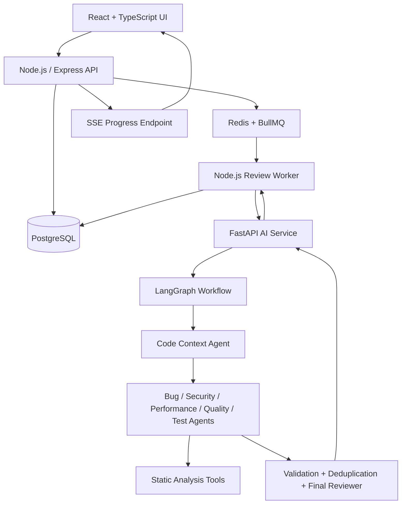

# Architecture — CodeMind AI

## 1. System overview



## 2. Service ownership
### Frontend
React, TypeScript, Vite, Tailwind CSS, Monaco Editor, React Router, Axios, Recharts, Lucide React.

### Node.js service
Owns authentication, users, projects, review lifecycle, job queue, user-facing APIs, authorization, report exports, and progress delivery. Use Express + TypeScript + Zod. Use a single defined database access layer for Node-owned application records.

### Python AI service
Owns LangGraph workflow, agent modules, Pydantic schemas, provider adapters, prompt construction, and static-analysis orchestration. FastAPI internal routes are not exposed publicly. It can return results to the Node worker; avoid two services independently migrating or mutating the same tables.

### Infrastructure
PostgreSQL for durable records; Redis/BullMQ for asynchronous work; Docker Compose for local development. Use structured logs and health checks.

## 3. Review workflow
1. Node validates request, authenticates owner, creates review row in `queued`.
2. BullMQ worker claims job and marks review `running`.
3. Worker calls private FastAPI endpoint with service authentication and correlation ID.
4. FastAPI validates input, creates typed LangGraph state, parses files without execution.
5. Run configured deterministic analyzers in isolated, resource-limited execution.
6. Run context preparation, then independent LLM agents concurrently when possible.
7. Validate outputs, normalize paths/lines, deduplicate findings, and generate summary.
8. Return final structured result plus agent run metadata.
9. Node persists findings and status, then publishes progress events.
10. UI refreshes status and displays report.

## 4. State machine
`queued -> running -> completed`
`queued -> cancelled`
`running -> completed | failed | partially_completed | cancelling -> cancelled`

Only allow valid transitions. Persist transitions and timestamps. Retries must not create duplicate findings; use transaction boundaries and idempotent upsert or delete-and-replace strategy for a review attempt.

## 5. Agent contracts
Each agent receives a minimal, relevant code context and returns a Pydantic-validated result. Do not allow an agent to alter another agent's raw output. Store agent status, duration, retry count, model, token usage where available, and error category. The final reviewer may deduplicate and rank findings but must not invent code evidence.

## 6. Progress delivery
Use SSE for one-way server-to-client updates unless bidirectional control is needed. Event payload:
```json
{
  "reviewId": "uuid",
  "agentName": "security",
  "status": "running",
  "message": "Analyzing source",
  "timestamp": "ISO-8601"
}
```
Persist important events or make current status recoverable after reconnect. Include heartbeat and client reconnect behavior.

## 7. Failure handling
- Per-agent timeout and limited retries.
- Exponential backoff only for transient errors.
- Provider rate-limit handling.
- Cancellation signal propagated to workflow and queue worker.
- Partial report if configured minimum analysis succeeds; otherwise mark failed.
- Never return fabricated success or empty “clean” results when a tool/agent did not run.
- Redact secrets and avoid logging submitted source by default.

## 8. Internal service security
- FastAPI internal endpoints require service-to-service authentication.
- Bind internal service to private Docker network where possible.
- Validate payload sizes and allowed languages.
- Use correlation IDs and request timeouts.
- Do not expose stack traces or internal provider errors to end users.
